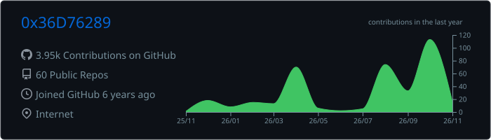
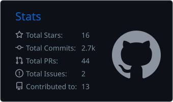
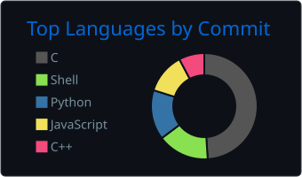
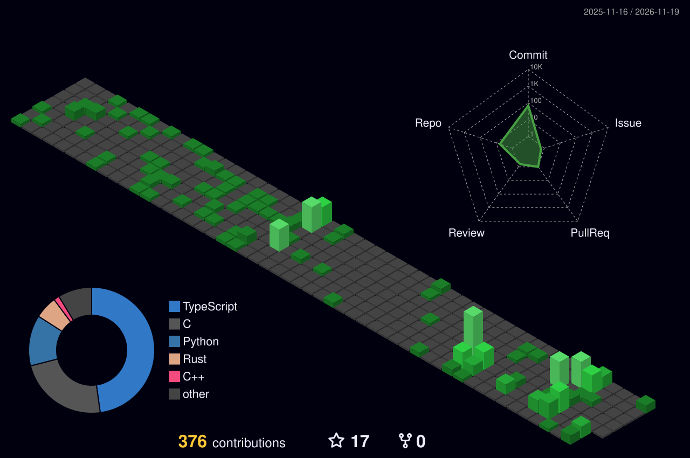

<div align="center">



<br>

[](https://keys.openpgp.org/search?q=75E9F067AFB3071D513EBCE732A9148D044EBD21)
[](https://42.fr)
[](#-contact)
[](https://en.wikipedia.org/wiki/Paris)


</div>

## `$ whoami`

```sh
$ grep 0x36D76289 /etc/passwd
0x36D76289:x:42:42:cypherpunk geek who loves code:/home/0x36D76289:/bin/zsh
```

Student at **[42 Paris](https://42.fr)**, into low-level programming, security tooling, and systems
projects that require understanding what really happens under the hood.

- 🦀 currently hacking on **[kfs](https://github.com/0x36D76289/kfs)**, a kernel from scratch in Rust
- 🔬 interested in binary analysis, ELF internals, and network protocols
- 🔐 privacy first: PGP preferred, see [contact](#-contact)

## `$ ls ~/projects`

| project | what | stack |
| --- | --- | --- |
| [**kfs**](https://github.com/0x36D76289/kfs) | kernel from scratch: GDT, IDT, paging, memory management | `Rust` `x86 ASM` |
| [**woody_woodpacker**](https://github.com/0x36D76289/woody_woodpacker) | ELF binary packer: code injection and encryption | `C` `ELF` |
| [**malloc**](https://github.com/0x36D76289/malloc) | libc malloc reimplementation | `C` |
| [**ft_ping**](https://github.com/0x36D76289/ft_ping) | raw socket ping reimplementation with ICMP | `C` `sockets` |
| [**ft_otp**](https://github.com/0x36D76289/ft_otp) | TOTP/HOTP implementation (RFC 4226 / 6238) | `C` |
| [**minishell**](https://github.com/0x36D76289/minishell) | POSIX shell with pipes and redirections | `C` |
| [**Arachnida**](https://github.com/0x36D76289/Arachnida) | web scraper and metadata extractor (OSINT) | `Python` |
| [**ft_transcendence**](https://github.com/0x36D76289/ft_transcendence) | fullstack web platform: Pong, 2FA, tournaments | `Django` `React` `Docker` |

<sub>all repositories → [github.com/0x36D76289?tab=repositories](https://github.com/0x36D76289?tab=repositories)</sub>

## `$ cat ~/.stack`

<div align="center">


<br>


</div>

```text
security     OSINT · binary analysis · network protocols · ELF
systems      memory management · kernel dev · sockets · IPC · x86 ASM
tools        GDB · Ghidra · Wireshark · nmap · QEMU
```

## `$ git log --stat`

<div align="center">









<picture>
  <source media="(prefers-color-scheme: dark)" srcset="https://raw.githubusercontent.com/0x36D76289/0x36D76289/output/github-snake-dark.svg">
  <source media="(prefers-color-scheme: light)" srcset="https://raw.githubusercontent.com/0x36D76289/0x36D76289/output/github-snake.svg">
  
</picture>

</div>

## `$ gpg --fingerprint` <a id="-contact"></a>

```text
email     private, ask for it (PGP preferred)
pgp       75E9 F067 AFB3 071D 513E  BCE7 32A9 148D 044E BD21
keyserver https://keys.openpgp.org
```

<div align="center"><sub>stats regenerated daily by GitHub Actions</sub></div>
